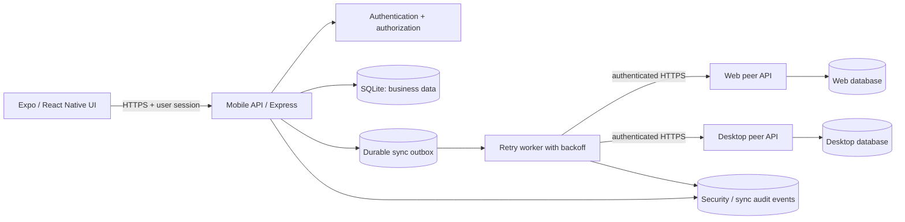

# Design — Export Client Mobile Sync

> **Status:** Design proposal for review. This document describes intended architecture and acceptance criteria; it does not certify production readiness or claim every control is implemented.
>
> **Scope:** Mobile client, local API/database, and synchronization with Web and Desktop peer backends.
>
> **Repository:** `muchlisbstg/export-client-mobile-sync`

## 1. Goals

- Provide a maintainable mobile experience for export product discovery and inquiry creation/tracking.
- Preserve data locally on the backend and make synchronization resilient to intermittent network failures.
- Make retries safe through idempotency and durable outbox processing.
- Enforce authentication, authorization, and tenant isolation on the server—not by trusting the mobile UI.
- Make consistency failures visible and testable across Web, Mobile, and Desktop nodes.
- Keep CI as a release gate; AI suggestions must never bypass tests or human approval.

### Non-goals for the current MVP

- Processing real money or enabling production payments.
- Claiming legal, customs, export-control, certification, or Syariah compliance without the applicable expert review.
- Treating peer-to-peer replication as a substitute for a formally designed distributed database.
- Storing long-lived service secrets in the mobile application bundle.

## 2. Current context and known risks

The repository README describes Expo/React Native, a Node.js/Express API, SQLite persistence, and optional peer synchronization using an outbox, retries, and conflict logging.

Previously inspected CI evidence identified two important issues to resolve before release:

1. The three-backend interoperability test did not converge within 20 seconds: Web reported 3 records / 3 outbox items, Mobile 1 / 0, and Desktop 3 / 2; conflict counts were zero in that run.
2. Expo dependency validation reported `react@19.3.1` where `19.3.0` was expected in the failing run. The declared package manifest should remain aligned with Expo's expected dependency versions and lockfile.

These are evidence from particular workflow runs, not a claim about the latest run. Check current CI before deciding whether either issue remains open.

## 3. System architecture

**Trust boundaries**

- The mobile app is an untrusted client. It may render UI and submit requests, but must not decide tenant membership, roles, ownership, or peer credentials.
- The public application API and internal peer-sync API are separate logical surfaces with different authentication and network exposure.
- Each backend owns its local persistence. Replication may be delayed; an accepted local write is not proof that every peer has converged.
- Secrets belong in backend environment/secret storage, never in `EXPO_PUBLIC_*` variables or source control.

## 4. Component responsibilities

| Component | Responsibility | Required guardrails |
|---|---|---|
| Mobile UI | Catalog browsing, inquiry forms, status and sync feedback | Client-side validation improves UX only; server revalidates |
| API layer | Validate requests and expose versioned contracts | Authentication, authorization, rate limits, safe errors |
| Domain/service layer | Apply business rules and valid state transitions | Explicit invariants and unit tests |
| SQLite repository | Persist domain data and migration state | Transactions, foreign keys, constraints, backups |
| Outbox worker | Deliver durable replication events | Retry/backoff, idempotency, bounded concurrency, observability |
| Peer receiver | Authenticate and validate incoming replication | Allowlisted peer identity, schema validation, deduplication |
| Conflict handler | Record incompatible duplicate identities | No silent overwrite; traceable resolution |
| CI | Test code and interoperability | A failing mandatory gate blocks release |

## 5. Core data design

Names below are logical design names; map them to existing schema after inspecting migrations before implementing changes.

- **Tenant**: business/account boundary.
- **User**: authenticated identity.
- **TenantMembership**: user-to-tenant relationship with a role and status. A user may belong to multiple tenants.
- **Inquiry**: immutable or versioned business request, with tenant ownership, stable ID, tracking code, creator, timestamps, and validated payload.
- **OutboxEvent**: durable outbound replication item, including event ID, tenant ID, entity ID, event type, schema version, payload or payload reference, sequence/version, attempt count, next-attempt time, and delivery status.
- **InboxReceipt**: deduplication record for inbound event IDs, scoped to the receiving node.
- **SyncConflict**: event/entity identity, local and remote versions or payload hashes, peer, detection time, and resolution status. Avoid logging sensitive full payloads by default.
- **AuditEvent**: actor, tenant, action, target, outcome, timestamp, and correlation ID. Redact tokens and secrets.

### Invariants

1. Every tenant-owned record has a valid tenant relationship enforced server-side and, where possible, by database constraints.
2. A user may read or mutate a record only when the active tenant is verified against server-side membership and the role permits the action.
3. A repeated event ID with the same canonical content is an idempotent duplicate, not a second write.
4. The same stable identity with different canonical content is a conflict; never silently overwrite.
5. Domain changes and creation of their outbox events must be committed atomically in the same database transaction.
6. Acknowledging local persistence and acknowledging remote delivery are separate states.
7. Outbox records are not deleted until delivery/retention policy permits it; retries survive process restarts.
8. Monetary amounts, if introduced later, use integer minor units plus an explicit currency code; never use binary floating-point for ledger arithmetic.

## 6. Synchronization protocol

### Outbound flow

1. Validate and authorize the command.
2. In one SQLite transaction, write the domain record and a durable outbox event.
3. Commit and return the local result with a clear state such as `pending_sync` when remote delivery is outstanding.
4. Worker claims due events using a concurrency-safe claim/lease mechanism.
5. Worker sends an authenticated request with event ID, schema version, tenant context, and correlation ID.
6. Receiver validates peer credentials, payload schema, tenant authorization/mapping, and event identity.
7. Receiver atomically records the inbox receipt and applies the idempotent domain write.
8. Receiver acknowledges only after its transaction commits.
9. Sender marks the outbox item delivered only after a valid acknowledgement. Transient errors schedule retry; permanent validation/security failures go to a visible failed/dead-letter state for investigation.

### Retry and ordering

- Use exponential backoff with jitter and a maximum delay; define retry ceilings and alert thresholds.
- Apply request timeouts and bounded concurrency so an unavailable peer cannot exhaust the process.
- Preserve per-entity or per-tenant ordering where business invariants require it; do not assume global ordering across peers.
- Make retries safe even when a peer commits successfully but the acknowledgement is lost.
- Do not hold database transactions open while performing network calls.
- Record last attempt, next attempt, attempt count, peer, result class, and correlation ID.

### Conflict policy

- **Identical duplicate:** acknowledge as already applied.
- **Same ID, different content:** record conflict and reject automatic overwrite.
- **Stale version:** reject or route through a documented version policy.
- **Unrecognized schema version:** reject safely and emit an operational event.
- **Tenant mismatch:** reject; never move a record between tenants as a side effect of sync.

Automatic conflict resolution is permitted only for fields with a documented deterministic rule. Commercially significant fields should require explicit business resolution and audit history.

### Consistency model and status

The system is eventually consistent while peers are reachable and retries continue; temporary divergence is expected. The UI must distinguish:
- **Saved locally**
- **Sync pending**
- **Synced to required peers**
- **Sync needs attention / conflict**

Do not label a record globally “synced” merely because it was queued or one peer acknowledged it. Define which peers are required for each workflow.

## 7. Security and tenant isolation

- Authenticate user requests using a server-validated session/token strategy; rotate/revoke credentials where supported.
- Derive tenant access from server-side membership. Never trust a client-supplied tenant ID without checking membership and permissions.
- Apply object-level authorization to every read, update, export, and sync operation.
- Use distinct credentials for user API access and peer-to-peer service authentication.
- Require HTTPS for remote peers; validate peer URLs and prevent SSRF by restricting allowed hosts/ports and blocking loopback, link-local, and private targets where inappropriate for the deployment.
- Compare secrets safely, keep them out of logs, and rotate them without exposing them to clients.
- Apply request-size limits, schema validation, rate limits, and safe error responses.
- Use least-privilege database/file permissions and protect SQLite files, backups, WAL files, and exports.
- Audit authentication failures, authorization denials, tenant switches, sync failures, conflict creation, and administrative changes.
- Redact credentials, personal data, and commercially sensitive fields from telemetry.
- Add retention and deletion policies that account for audit/legal requirements and replication copies.

### Required negative tests

- Unauthenticated access to protected routes.
- User A in Tenant A attempts to read or mutate Tenant B data.
- User with read-only role attempts a write.
- Client forges active tenant or record ownership.
- Invalid, missing, or revoked peer credential.
- Unauthorized peer sends a valid-looking event.
- Duplicate event with identical content and duplicate event with changed content.
- Malformed/oversized payload and unsupported schema version.
- Sync retry after receiver commit but before sender receives acknowledgement.

## 8. Mobile UX design

### Primary navigation

1. **Catalog** — search/filter products and view product details.
2. **Inquiries** — list inquiries with status and last-updated time.
3. **Create inquiry** — validated form with clear required fields and confirmation.
4. **Activity / Sync** — pending, successful, failed, and conflict states with safe retry affordance.
5. **Account / Tenant** — current business context and membership-aware switching, if multi-tenant UX is enabled.

### Interaction rules

- Show loading, empty, offline, validation, permission-denied, and server-error states.
- Preserve unsent form input where safe; clearly disclose whether it is saved locally.
- Disable duplicate submission while a request is in flight, but still rely on server idempotency.
- Display timestamps with timezone context where relevant.
- Never expose peer secrets, internal endpoint credentials, stack traces, or raw database errors.
- Avoid presenting demo catalog entries as verified suppliers or certified products.
- Use accessible labels, touch targets, contrast, and screen-reader semantics.

## 9. API and versioning principles

- Keep the mobile-facing API and internal peer-sync contract separately documented.
- Validate all request bodies and query parameters against explicit schemas.
- Return stable error codes and correlation IDs; avoid leaking implementation details.
- Use idempotency keys for commands that may be retried by the client.
- Include schema/event versions in replication payloads and define backward-compatibility rules.
- Document authentication, authorization, pagination, rate limits, and error responses for each route.
- Treat changes to event schemas as migrations: test old/new compatibility before rollout.

## 10. Observability and operations

Track, at minimum:
- Outbox pending count and oldest pending age.
- Delivery attempts and success/failure rates by peer.
- End-to-end convergence time in integration tests.
- Conflict count and age of unresolved conflicts.
- Unauthorized peer requests and tenant authorization denials.
- Database busy/locked errors, migration failures, and process restarts.
- API latency and error rate by route.

Logs should use structured fields and correlation IDs, not secrets or full sensitive payloads. Define alert thresholds and an operator runbook for a stalled outbox, unreachable peer, bad credential, schema incompatibility, and conflict backlog.

## 11. Migration and recovery

- Back up the SQLite database before schema migrations; include associated WAL state using a supported backup procedure.
- Make migrations transactional where supported, versioned, repeatable only when designed to be, and safe on representative database copies.
- Test fresh install, upgrade from each supported schema version, interrupted migration, and rollback/recovery procedure.
- Validate foreign keys and data invariants after migration.
- Define backup frequency, retention, restore objectives, and a tested restore procedure before production data is used.
- Do not run destructive migration or data-repair commands against production without an explicit approval and verified backup.

## 12. CI and release gates

A release candidate must satisfy all applicable gates:

1. Dependency/lockfile consistency and Expo compatibility check.
2. Typecheck and unit/API tests.
3. SQLite migration and tenant-isolation tests.
4. Security tests for user and peer authorization.
5. Android bundle/export check; platform-specific checks for other supported platforms.
6. Three-backend interoperability test with Web, Mobile, and Desktop.
7. Retry/idempotency tests, including lost acknowledgement and restart recovery.
8. No unresolved critical/high security findings for the release scope.
9. Human review of the exact commit SHA and successful required checks.

### Interoperability acceptance criteria

- A record created on each origin node eventually appears on every required peer within the agreed test timeout.
- Replaying the same event does not create duplicate records or duplicate side effects.
- An unavailable peer does not lose queued events; delivery resumes after recovery.
- A receiver restart does not lose committed writes or inbox deduplication state.
- Same-ID/different-payload events produce an observable conflict and do not silently overwrite data.
- Cross-tenant events are rejected and leave both tenants' data unchanged.
- The test asserts final database state and outbox/inbox status—not only HTTP 200 responses.

A failed interoperability test or dependency compatibility check is a release blocker until fixed and rerun successfully on the candidate commit.

## 13. Implementation sequence

| Priority | Work item | Completion evidence |
|---|---|---|
| P0 | Reproduce and diagnose three-peer convergence failure | Failing test isolated; event flow and outbox transitions documented |
| P0 | Verify atomic domain-write + outbox transaction | Tests prove rollback leaves neither partial domain write nor orphan event |
| P0 | Verify tenant isolation for every protected route and sync event | Positive same-tenant and negative cross-tenant tests pass |
| P0 | Fix Expo dependency/lockfile mismatch if still present | Expo compatibility check and Android export pass on same SHA |
| P1 | Add inbox deduplication and lost-acknowledgement coverage | Duplicate/retry/restart tests pass |
| P1 | Add sync status/metrics and conflict runbook | Observable queue age, delivery failures, and conflict backlog |
| P1 | Test migration and recovery on representative sanitized data | Upgrade, interruption, backup, and restore evidence |
| P2 | Improve mobile offline UX and accessibility | UI tests and documented offline behavior |
| P2 | Review production deployment, privacy, legal, and relevant Syariah requirements | Named human approvals and evidence; no implied compliance claim |

## 14. Definition of done

- Design decisions are reflected in code, API contracts, and migration documentation.
- Required automated tests pass on the exact reviewed commit.
- No unresolved P0 security, tenant-isolation, or convergence defect remains.
- Sync status in the UI matches durable server-side state.
- Operational dashboards/runbooks cover retries, unavailable peers, and conflicts.
- Secrets are not committed or bundled into the mobile client.
- Release approval is explicit and human-owned. This document alone does not authorize merging, deployment, or real-data/real-money use.

## 15. Related evidence

- [Repository README](README.md)
- [GitHub Actions run — interoperability and verification](https://github.com/muchlisbstg/export-client-mobile-sync/actions/runs/40175867084)
- [GitHub Actions run — dependency compatibility and interoperability](https://github.com/muchlisbstg/export-client-mobile-sync/actions/runs/40257995651)
- [PR #74 — peer allowlist test adjustment](https://github.com/muchlisbstg/export-client-mobile-sync/pull/74)

Re-check these workflow runs and the candidate commit before treating any historical failure as current.
