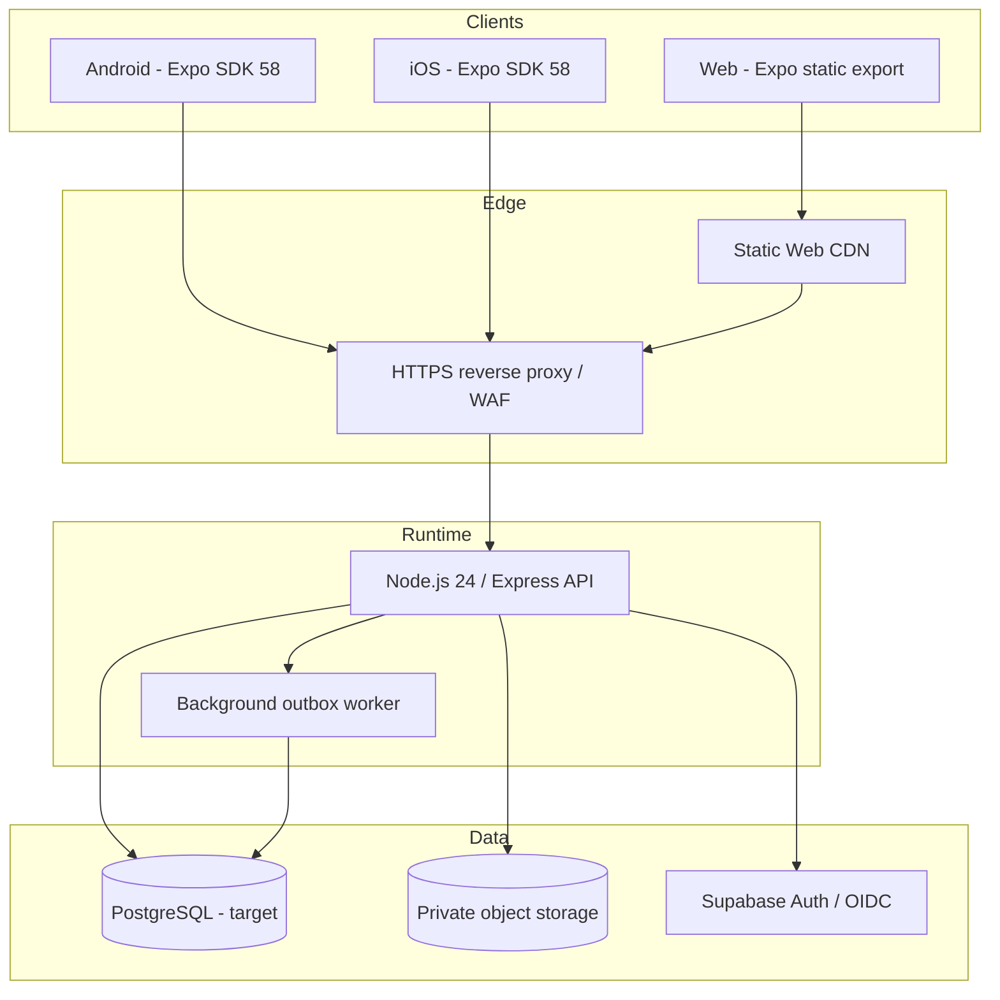

# Deployment Blueprint — Export Client Mobile Sync

**Prepared:** 2026-11-04  
**Source baseline:** `73e75edad71c5a6f8819e80c5ffdeabf32314c3d`  
**Status:** architecture blueprint only; no hosting purchase, provisioning, deployment, migration, or staging mutation.

## 1. Design objectives

- Indonesia-first, global-ready single-enterprise product.
- Android, iOS, and Web share the Expo SDK 58 application and API contract.
- One authoritative backend for authentication, enterprise membership, roles, site scope, transactions, inventory, traceability, and audit.
- Keep mobile/browser clients free of database credentials and privileged service keys.
- Preserve auditable CI evidence and human-controlled release gates.
- Avoid provider lock-in and avoid redesign when infrastructure funding becomes available.

## 2. Target logical architecture

This is the intended end-state, not a description of services currently running. Current source uses `better-sqlite3` directly in the Express process and Supabase Auth for token verification. PostgreSQL repository abstraction, production object storage, and background worker separation must be implemented and validated before claiming this diagram is deployed.

## 3. Deployment units and responsibilities

| Unit | Target | Responsibility | Current readiness |
|---|---|---|---|
| Mobile | Expo SDK 58 + EAS build pipeline | Android/iOS native packages; runtime API URL via public app config | SDK dependencies declared; platform build evidence still required |
| Web | Expo static export `dist/` + CDN/static host | Browser bundle, HTTPS, cache headers, SPA routing | Export workflow exists; current Vercel deployment does not prove Express API hosting |
| API | Linux container or managed Node runtime on a small VPS | Express API, auth verification, authorization, business rules, rate limits | Source exists; no verified production API host/runtime |
| Database | Managed PostgreSQL (target) | Transactional business data, constraints, RLS, migrations, backup/PITR | Supabase staging exists but has no application schema; no migration approved |
| Object storage | Private S3-compatible bucket or Supabase Storage | Evidence, QC documents, contracts, shipment attachments | Not yet established; storage URI in a row is not a secure document service |
| Background jobs | Separate worker process using durable outbox | Retry, peer sync, notifications, reconciliation | Outbox logic exists in API process; production worker separation is future work |
| Identity | Supabase Auth / OIDC | Authentication and identity lifecycle | Auth verifier exists; production identity configuration not certified |
| Observability | Structured logs, metrics, tracing, alerting | Availability, latency, errors, audit and security events | Must be selected and configured before production |

## 4. Data and runtime architecture decisions

### 4.1 Database transition

The current Express source opens SQLite and issues schema DDL at server startup. It is not safe to scale this design horizontally or mount a shared SQLite file over network storage.

Target sequence:

1. Keep current SQLite for isolated development and synthetic tests only.
2. Complete physical schema provenance and reconciliation against the actual runtime database (host, entrypoint, working directory, effective `API_DB_PATH`, snapshot consistency).
3. Approve transaction-party bridge, composite tenant/transaction/site constraints, role model, and RLS design.
4. Build a repository/data-access boundary and PostgreSQL adapter while preserving the HTTP contract.
5. Test migrations, constraints, RLS, rollback, and concurrency on disposable PostgreSQL with synthetic fixtures.
6. Only after explicit approval, apply a reviewed migration to the dedicated staging project; no operational-data export or import is implied.
7. Run functional E2E and independent Security/Database review before any production cutover.

Do not dual-write SQLite and PostgreSQL. Define one authoritative store per environment and a controlled cutover/rollback plan.

### 4.2 API hosting topology

Initial production footprint should be one API instance behind HTTPS reverse proxy/load balancer, with:
- persistent database service or managed PostgreSQL endpoint;
- private networking for database and object storage;
- health/readiness probes that disclose no topology or secret metadata;
- graceful shutdown and bounded request/job draining;
- rate limiting at both edge and application layers;
- explicit CORS allowlist for known Web origins;
- encrypted secrets injected at runtime, never embedded in mobile/web bundles.

A single SQLite-backed instance may be used only as a time-limited internal pilot if the business accepts its backup, concurrency, recovery, and single-node limitations. It is not the recommended global production end-state.

### 4.3 Web and mobile configuration

- Web static build: `npm ci` → Expo dependency check → tests/typecheck → `expo export --platform web` → immutable artifact → static hosting.
- Android/iOS: reproducible native builds from the same tagged source SHA; unsigned Simulator artifacts for CI, signed store artifacts only in a separately approved release workflow.
- Configure `EXPO_PUBLIC_API_URL` per environment. Treat every `EXPO_PUBLIC_*` value as public.
- Never put Supabase service-role keys, database passwords, sync shared secrets, or signing credentials in app config.
- Use separate development, staging, and production identities and endpoints.

## 5. CI/CD and release governance

| Stage | Automated checks | Approval / deployment boundary |
|---|---|---|
| Pull request | Unit/negative/regression tests, typecheck, npm audit artifact, Expo SDK check, Web export, Android APK, iOS Simulator build/launch | No deployment; reviewer feedback only |
| Staging candidate | Synthetic fixtures, API contract, RLS/constraint tests, functional E2E, backup/restore rehearsal | Human approval before any staging mutation |
| Production candidate | Signed mobile builds, SBOM/audit disposition, security/database review, legal/Syariah review, monitoring and rollback rehearsal | Protected environment approval; manual release authorization |
| Production operation | Health/metrics, audit review, backup verification, incident response | No AI auto-approval or automatic migration |

CI must record repository, branch, commit SHA, lockfile checksum, Node/npm versions, workflow run URL, artifacts, and test totals. Build success is not equivalent to security approval or production readiness.

## 6. Security, privacy, and compliance controls

- Server-side authentication and authorization for every protected endpoint; deny by default.
- Enterprise, role, transaction party, and site assignment must be resolved from trusted server-side records.
- PostgreSQL RLS is defense in depth, not a substitute for API authorization.
- Private object storage with short-lived signed URLs, content-type/size validation, malware scanning, retention and access audit.
- TLS in transit; encryption at rest; least-privilege runtime identities; key rotation; no secrets in logs.
- Data minimization, retention, backup access, incident response, and cross-border transfer review for Indonesia and destination markets.
- Trade documentation, origin/traceability, customs/export obligations, and country-specific requirements reviewed by qualified legal/compliance advisors.
- Akad, ownership/authority to sell, goods specification, pricing, fees, delivery risk, refund/cancellation, financing, and payment flow require qualified Syariah and legal review before transaction/payment activation. AI and CI are advisory, never approvers.

## 7. Infrastructure budget gate

No paid infrastructure is required to execute the current readiness work. When funding is available, select provider based on:
- Indonesia/Southeast Asia region and latency to target users;
- data residency, privacy, export and cross-border requirements;
- managed PostgreSQL, backups/PITR, private networking and object storage;
- TLS/WAF, monitoring, support, recovery objectives and predictable monthly cost;
- documented exit/export path and infrastructure-as-code portability.

Before purchase, prepare a costed bill of materials for pilot and production tiers, including compute, database, storage, bandwidth, backups, logs, domain, email, build/signing services, and support. No vendor account or region is assumed by this blueprint.

## 8. Go-live gates

- [ ] P0 endpoint authorization matrix and negative/regression tests pass on one candidate SHA.
- [ ] Independent Security and Database reviews approved.
- [ ] Physical schema provenance and schema reconciliation complete.
- [ ] PostgreSQL constraints and RLS verified using synthetic fixtures.
- [ ] API repository abstraction and PostgreSQL adapter tested.
- [ ] Private document storage and retention controls verified.
- [ ] Android, iOS, and Web build artifacts verified from same release SHA.
- [ ] Backup/restore, rollback, monitoring, incident response and recovery objectives tested.
- [ ] Indonesia legal/export and destination-market review complete.
- [ ] Syariah advisor approves relevant akad and transaction/payment flows.
- [ ] Human release approval recorded; signed builds and production deployment authorized.

**Current disposition:** blueprint prepared; hosting spend remains deferred. This document does not certify a production host, live API, database migration, or release approval.
