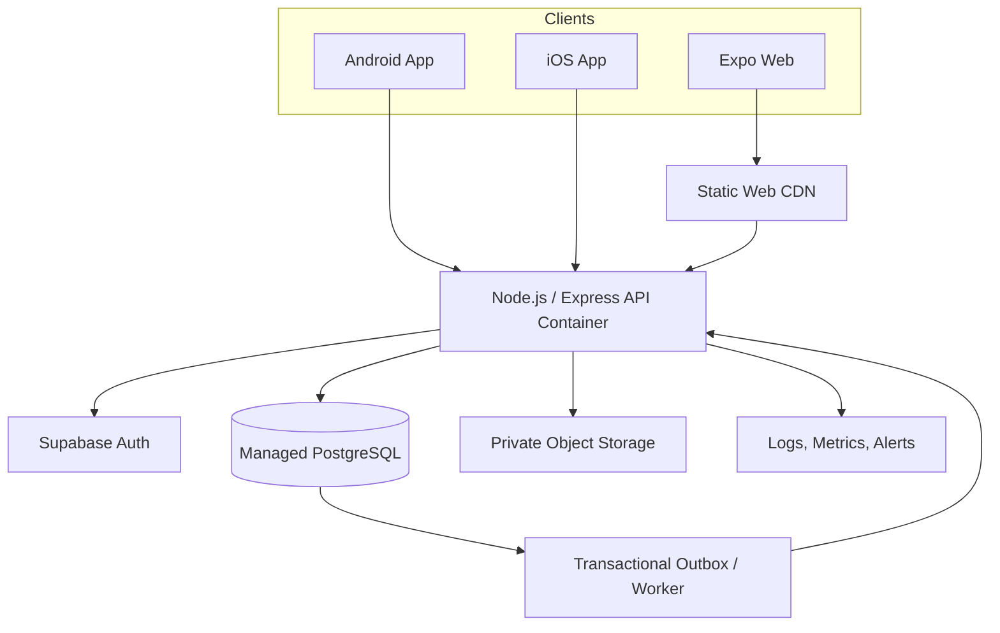

# Deployment Blueprint — Budget-Gated

**Status:** architecture blueprint only. No infrastructure has been provisioned, no hosting plan purchased, and no deployment authorized.  
**Design baseline:** `main` at `73e75edad71c5a6f8819e80c5ffdeabf32314c3d`.  
**Product direction:** one configured operating enterprise, role-based internal operations, external buyer/seller counterparties, Indonesia-first with international expansion.

## 1. Target topology

The mobile and web clients call the same versioned API. The clients must not connect directly to production business tables. Authorization, enterprise context, role checks, site scope, audit events, and transaction rules remain server-enforced.

## 2. Hosting and runtime decisions

| Layer | Target pattern | Decision gate |
|---|---|---|
| Web | Expo static export (`dist/`) on a static CDN | Select provider after domain, cost, region, and cache review |
| API | Long-running Node.js/Express service packaged as a container | Select a managed container service or small VM after budget approval |
| Database | Managed PostgreSQL with reviewed constraints and RLS | Select provider/region after data-residency and operating-cost review |
| Authentication | Supabase Auth or an approved OIDC provider | Preserve server-side token verification; no client metadata privilege |
| Evidence/files | Private object storage with short-lived signed URLs | Define retention, malware scanning, checksum, and access policy |
| Background work | Transactional outbox plus worker; retries and idempotency | Do not rely on an in-memory timer as the only durable queue |
| Delivery | GitHub Actions build/test/artifact pipeline | Production deploy and store submission remain manual approval gates |

**Important runtime boundary:** the current API uses `better-sqlite3` and a SQLite fallback path (`API_DB_PATH`). Do not place that database on an ephemeral serverless filesystem or treat a successful Vercel frontend deployment as proof that the Express API is hosted. Before production, implement and test a PostgreSQL repository adapter, durable queue semantics, and backup/restore procedures. SQLite remains suitable for isolated local tests, not the target shared production database.

## 3. Environments and configuration

Maintain separate development, staging, and production environments with separate credentials, databases, storage buckets, and callback/origin allowlists.

Configuration names already present or expected in source include:

- Client: `EXPO_PUBLIC_API_URL`, `EXPO_PUBLIC_SUPABASE_URL`, `EXPO_PUBLIC_SUPABASE_ANON_KEY`.
- API: `API_HOST`, `API_PORT`, `API_DB_PATH` (local/test only), `WEB_ORIGINS`, `SUPABASE_URL`, `SUPABASE_ANON_KEY`, `ADMIN_USER_IDS`, `SINGLE_ENTERPRISE_ID`.
- Replication (only if retained after architecture review): `SYNC_SHARED_SECRET`, `SYNC_NODE_ID`, `SYNC_PEERS`.

Never commit values. Use GitHub OIDC to obtain short-lived deployment credentials where supported, and a secrets manager for runtime secrets. Production origins must be exact HTTPS origins; do not use wildcard CORS. Keep API and database in the same selected region unless a documented residency/availability decision says otherwise.

## 4. Data and security architecture

1. PostgreSQL becomes the authoritative production business store; mobile/web clients access it only through the API unless a separately reviewed Supabase RLS design explicitly permits a narrow client path.
2. Tenant/enterprise, transaction-party, site, assignment, and audit invariants must be database-enforced as well as application-enforced.
3. Use append-only audit records for privileged changes, authorization decisions, inventory movements, and evidence lifecycle.
4. Use idempotency keys and transactional outbox records for retries and cross-service events.
5. Store documents, QC evidence, export certificates, and shipment records in private object storage. Persist metadata, hashes, actor, tenant, timestamps, and retention policy in PostgreSQL.
6. Apply TLS, least-privilege service identities, rate limits, request-size limits, secure headers, dependency scanning, secret scanning, and tested restore procedures.
7. Define RPO/RTO, backup retention, log retention, incident response, and key rotation before production launch.

## 5. Delivery pipeline

- Pull request: unit/regression tests, authorization matrix, schema contract inspection, typecheck, Expo SDK compatibility, npm audit evidence, Web export, Android preview APK, iOS Simulator build, and interoperability tests.
- Release candidate: immutable artifacts tied to a commit SHA; SBOM and dependency disposition; reviewer sign-off; staging E2E using synthetic data.
- Production: manual approval, reviewed migration plan, backup/restore checkpoint, deployment health verification, smoke tests, rollback/forward-fix decision, and post-release monitoring.
- Mobile stores: Android signing and Play Console release; iOS signing, provisioning profiles, Apple Developer account, App Store Connect review. Simulator/APK preview artifacts are not store-ready signed releases.

The existing GitHub workflows can build preview artifacts. They do not, by themselves, establish a production API deployment or authorize an App Store/Play Store release.

## 6. Indonesia and international operating controls

- Select hosting/database regions only after assessing Indonesian data-protection, electronic-system, export documentation, and cross-border transfer obligations with qualified counsel.
- Preserve traceability from plantation/origin site through packing house, warehouse, port, shipment, and buyer receipt.
- Keep commodity origin, lot genealogy, QC, inventory, handover, shipment, and evidence records linked by stable identifiers and append-only audit history.
- Keep payment and financing workflows disabled until the akad, ownership/risk transfer, fee structure, settlement flow, and contractual documents are reviewed by legal, banking, and Syariah advisors. D/P, D/A, LC, and bank guarantees are subject to that approval; this blueprint does not authorize any payment product or interest-bearing arrangement.

## 7. Budget-gated rollout

| Phase | Scope | Spend / approval |
|---|---|---|
| 0 — Now | GitHub-based tests, static analysis, build artifacts, source reconciliation, local synthetic fixtures | No new hosting spend; no deployment |
| 1 — Staging | One region, isolated API, managed PostgreSQL, private storage, synthetic E2E | Requires budget owner approval and security/database gates |
| 2 — Pre-production | Production-like load, backup restore, observability, incident drill, legal/Syariah review | Requires release-candidate approval |
| 3 — Production | Controlled API/web rollout and store release | Explicit business, security, database, legal, and Syariah approval |

## 8. Open decisions before provisioning

- Hosting provider and region, based on total monthly cost, Indonesia/global latency, data-residency obligations, and operational support.
- PostgreSQL provider and whether the existing Supabase staging project is suitable beyond test use.
- Final transaction-party model: one operating enterprise with buyer/seller counterparties, or separately registered tenant entities. Align the schema ADR before any migration.
- Object storage provider, retention classes, and evidence access policy.
- API deployment topology, worker topology, backup strategy, RPO/RTO, and incident ownership.
- Store accounts, signing custody, release ownership, and customer support model.

**No infrastructure, database migration, DNS change, secret creation, deployment, or paid subscription is authorized by this document.**
